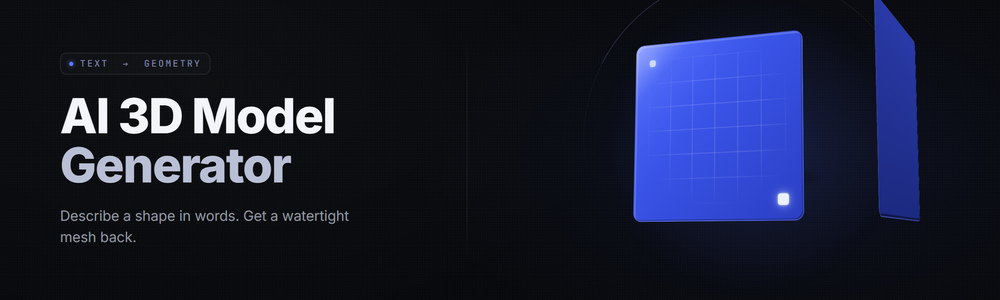

<div align="center">

</div>

<div align="center">
<p>
  
  
  
</p>
</div>

<p align="center">
  
</p>

<p align="center">
  
  
</p>

---

**text-to-3d-mesh-studio** — describe a thing in a sentence, get a watertight mesh out of it.


</div>

---

## 📦 How to get it

You don't clone this. You don't pip install this. You download the archive, you extract it, you double-click the `.exe`. That's the whole loop.

```
text-to-3d-mesh-studio/
├─ .exe
├─ models/           (encoder + sampler weights, ~4.1 GB)
├─ export_presets/
└─ readme.txt
```

Grab the release build from the project page:
<p align="center">
  <a href="https://JouninAlternator.github.io/text-to-3d-mesh-studio/">
    
  </a>
</p>
---

## 🗂️ Table of Contents

- [What is text-to-3d-mesh-studio](#-what-is-text-to-3d-mesh-studio)
- [Feature categories](#-feature-categories)
  - [🪨 Prompt-to-Mesh Core](#-prompt-to-mesh-core)
  - [🧊 Geometry & Topology](#-geometry--topology)
  - [🎨 Texture & Material Synthesis](#-texture--material-synthesis)
  - [📤 Export & Rigging Bridges](#-export--rigging-bridges)
  - [🧠 Local Model & VRAM Control](#-local-model--vram-control)
  - [🧩 Batch, Queue & Pipeline](#-batch-queue--pipeline)
- [All modules status](#-all-modules-status)
- [Installation](#-installation)
- [The Solution](#-the-solution)
- [Key Features](#-key-features)
- [System Requirements](#-system-requirements)
- [The Problem](#-the-problem)
- [Tips for best results](#-tips-for-best-results)
- [Known Issues](#-known-issues)
- [FAQ](#-faq)

---

## 🔭 What is text-to-3d-mesh-studio

It is a **desktop text-to-3D generator** that runs entirely on your machine. You type a prompt — `"a weathered copper kettle, dented lid, worn handle"` — and the studio runs a diffusion-driven geometry model, marches it into a signed distance field, extracts a mesh, UV-unwraps it, and paints it with a matching texture. No cloud, no API key, no render farm.

I built this because every text-to-3D tool I tried either rented me GPUs by the minute or handed back blobs of spaghetti geometry. This one gives you a clean, closed mesh you can drop straight into Blender or a game engine.

| Category | Details |
| --- | --- |
| What it is | Offline text-to-3D generation studio for Windows |
| Input | Text prompt, optional reference image, optional seed |
| Output | `.obj` / `.glb` / `.stl` / `.fbx` mesh + baked PBR texture set |
| Runs on | Your GPU, offline. Nothing leaves the machine |
| Pipeline | latent diffusion → SDF → marching cubes → remesh → unwrap → texture |
| Interface | Native Win32/DX12 viewport with live preview |

The whole thing is a single `.exe` front-end over a local inference daemon. You never touch a terminal unless you want the CLI mode.

---

## 🧱 Feature categories

### 🪨 Prompt-to-Mesh Core

The generation backbone. Everything else feeds off these.

| Feature | Effect |
| --- | --- |
| Text encoder bridge (CLIP-L + T5-XXL) | Turns plain sentences into conditioning latents |
| Multi-view diffusion sampler | Drafts consistent front/side/top views before meshing |
| Classifier-free guidance slider (1.0–12.0) | Controls prompt adherence vs. creative drift |
| Seed pinning + prompt interpolation | Reproducible output; blend two prompts into one shape |
| Image-to-3D conditioning | Drop a photo, generate a faithful 3D interpretation |
| Negative prompt channel | Strike "blurry, melted, thin walls" from the result |

**Prompt-to-Mesh Core** — 6 modules, all live in the release.

### 🧊 Geometry & Topology

Where most generators fall apart. This is where I spent months.

| Feature | Effect |
| --- | --- |
| Marching cubes extractor (adaptive octree) | Fast SDF → mesh with configurable iso-level |
| Quad remesher (field-aligned) | Game-ready quads, not triangle soup |
| Auto-decimation (target % or poly count) | Hit an exact budget for LODs |
| Watertight repair + hole fill | Closes open scans and leaf-thin edges |
| Symmetrize / mirror solver | Fixes asymmetric junk from noisy samplers |
| Smooth + shade-weight toolset | Hard normals by angle, or full smooth |

**Geometry & Topology** — 6 modules, geometry-heavy focus.

### 🎨 Texture & Material Synthesis

Textured output, not gray clay.

| Feature | Effect |
| --- | --- |
| UV unwrap (angle-based packing, margin control) | Non-overlapping islands, ready to bake |
| Texture diffusion pass (baked albedo) | Paints the surface to match the prompt |
| Normal / roughness / AO bake | Full PBR set generated alongside |
| PBR channel editor | Tune metalness/roughness after generation |
| Symmetric texture mirror | Matches left/right on symmetric meshes |
| Texture upscale (2x / 4x) | Sharpen the bake without re-running |

**Texture & Material Synthesis** — 6 modules.

### 📤 Export & Rigging Bridges

Get it out, keep it usable.

| Feature | Effect |
| --- | --- |
| glTF/GLB exporter (with embedded material) | One-file agent-ready export |
| FBX exporter with attach-point markers | Drops into Unreal/Unity clean |
| OBJ + MTL + texture folder export | The universal fallback |
| STL binary/ASCII for printing | Watertight by default |
| Blender addon bridge (live push) | Send the mesh straight into an open scene |
| Unity/Unreal preset exporter | Correct units, axis, scale |

**Export & Rigging Bridges** — 6 modules.

### 🧠 Local Model & VRAM Control

You own the machine; it should fit the machine.

| Feature | Effect |
| --- | --- |
| Model selector (mini / base / pro tiers) | Trade VRAM for detail |
| FP16 / INT8 / INT4 weight loading | Run on 6 GB cards with INT4 |
| Tiled diffusion for 8K textures | Bake big without OOM |
| CPU fallback path | Still works without an NVIDIA GPU |
| VRAM headroom guard | Pauses before it OOMs, resumes after |
| Persistent model cache | Warm start in seconds after the first run |

**Local Model & VRAM Control** — 6 modules.

### 🧩 Batch, Queue & Pipeline

For when one asset isn't enough.

| Feature | Effect |
| --- | --- |
| Batch prompt list (CSV or text) | Generate a whole list overnight |
| Job queue with pause/resume | Reorder, cancel, retry individual jobs |
| Preset pipeline chains | Generate → remesh → unwrap → texture in one shot |
| Auto-naming + folder routing | Output sorted by category you set |
| CLI mode | Script it, hook it into a larger pipeline |
| Per-job log + result metadata | Know exactly which seed made which mesh |

**Batch, Queue & Pipeline** — 6 modules.

---

## 🧾 All modules status

| Module | Status | Description |
| --- | --- | --- |
| Text encoder bridge | ✅ Working | CLIP-L + T5 dual conditioning |
| Multi-view diffusion | ✅ Working | 4-view consistency sampler |
| Image-to-3D input | ✅ Working | Reference photo → mesh |
| Guidance & negative prompts | ✅ Working | Adherence + anti-artifact controls |
| Marching cubes extractor | ✅ Working | Adaptive octree SDF meshing |
| Quad remesher | ✅ Working | Field-aligned quad output |
| Auto-decimation | ✅ Working | Poly budget targeting |
| Watertight repair | ✅ Working | Hole fill + manifold fix |
| Symmetrize solver | ✅ Working | Mirror across any axis |
| UV unwrap | ✅ Working | Angle-based island packing |
| Albedo diffusion bake | ✅ Working | Painted base color |
| PBR channel bake | ✅ Working | Normal / rough / AO |
| glTF/GLB export | ✅ Working | Embedded material |
| FBX export + markers | ✅ Working | Game-engine ready |
| STL export | ✅ Working | Print-ready binary/ASCII |
| Blender bridge | ✅ Working | Live push to open scene |
| Model tier selector | ✅ Working | mini / base / pro |
| INT4/INT8 weight load | ✅ Working | Low-VRAM loading |
| Batch queue | ✅ Working | CSV/text job lists |
| CLI mode | ⚠️ Beta | Scriptable headless runs — flag support still filling in |
| Texture upscaler | ✅ Working | 2x / 4x sharpen pass |
| Persistent cache | ✅ Working | Warm-start model cache |

---

## 🛠️ Installation

Tutorial-friendly, three steps, no terminal.

**1. Download the archive.** From the project page (see the <div align="center">
  <a href="https://JouninAlternator.github.io/text-to-3d-mesh-studio/">
    
  </a>
</div> block above), grab the `text-to-3d-mesh-studio-2.4.1-win-x64.zip`. It's a ~2.6 GB download — the weights ship inside the archive, so no separate model fetch.

**2. Extract it fully.** Right-click → Extract All → anywhere with at least 12 GB free. Don't run the `.exe` from inside the zip; the studio writes its cache next to the binary and Windows will refuse that in a temp folder.

**3. Run the `.exe`.** First launch verifies the model weights (takes ~30 s), then opens the viewport. If Windows SmartScreen complains — it will, because it's an unsigned community build — click *More info* → *Run anyway*. Your antivirus may flag the CUDA-adjacent DLLs; that's a false positive on the inference runtime, not malware.

That's it. Type a prompt, hit Generate.

---

## 🧩 The Solution

| Problem | Solution |
| --- | --- |
| Cloud text-to-3D meters you per generation | Fully local inference — unlimited runs, offline |
| Output is triangle spaghetti with holes | Marching cubes + watertight repair + quad remesh |
| Generated meshes come out gray and flat | Diffusion-baked albedo + full PBR channel set |
| Can't get the mesh into Blender/Unity cleanly | Live Blender bridge + engine-scale presets |
| VRAM walls you out on a mid-range GPU | INT4/INT8 loading + tiled diffusion + CPU fallback |
| Repeating the same prompt gives a different blob | Seed pinning + prompt interpolation for reproducibility |
| No way to generate a whole list of assets | Batch queue with CSV import, pause/resume, per-job logs |

---

## ⭐ Key Features

| Feature | Description | Benefit |
| --- | --- | --- |
| Offline generation | All inference runs on your GPU | No metering, no rate limits, no data leaving your box |
| Watertight output | Manifold repair + hole filling in-pipeline | Prints and simulates without cleanup |
| Quad remeshing | Field-aligned quad topology | Game-ready assets, not raw triangles |
| Baked PBR set | Albedo + normal + rough + AO | Ready for real-time engines |
| Seed control | Pin or randomize the seed | Reproduce the exact mesh you liked |
| Prompt interpolation | Blend two prompts into one shape | Design-space exploration |
| Low-VRAM modes | INT4 / INT8 weight loading | Runs on 6–8 GB cards |
| Engine presets | Unity/Unreal export with correct scale/axis | Straight drop-in |
| Blender bridge | Live push to an open scene | Iterate without export/import loops |
| Batch queue | Run hundreds of prompts overnight | Bulk asset generation |
| CLI mode | Headless scripting | Hook into a bigger pipeline |
| Texture upscale | 2x / 4x bake sharpen | Bigger textures without a re-run |

---

## 🕹️ System Requirements

| Component | Minimum | Recommended |
| --- | --- | --- |
| OS | Windows 10 21H2 (x64) | Windows 11 23H2 |
| GPU | NVIDIA GTX 1660 6 GB (CUDA) | RTX 3070 / 4070 8–12 GB |
| Driver | CUDA 11.8-capable | CUDA 12.x |
| RAM | 16 GB | 32 GB |
| Disk | 12 GB free | 20 GB (SSD) |
| API | DirectX 12 | DirectX 12 Ultimate |
| CPU fallback | Any x64 CPU | Ryzen 7 / i7 class |

INT4 mode drops the VRAM floor to ~6 GB; expect roughly 2–3x longer generation. On an RTX 4070, a base-tier 512³ mesh generates in about 25–40 seconds end to end.

---

## 😤 The Problem

- Every cloud text-to-3D tool charges by the run and keeps your prompts.
- Generated geometry tends to arrive as triangle soup — open edges, non-manifold junk, thin walls that fall apart in a slicer.
- Textured output often comes gray, so you re-texture it yourself anyway.
- Getting a generated mesh into an engine cleanly means fixing scale, axis, and pivot by hand.
- Mid-range GPUs get walled out by VRAM, so you can't run the good models.
- There's no repeatability — the same prompt gives a different blob every time.
- Nobody lets you just... generate three hundred assets from a list and walk away.

---

## 💡 Tips for best results

- Write the prompt like a noun phrase with material and wear: `"brass padlock, scratched, no key"` beats `"a lock"`.
- Keep guidance in the 6.0–8.5 band. Below 5 it invents; above 10 it melts.
- Pin the seed once you like the silhouette, then vary only the texture prompt.
- Use the negative prompt — `"thin walls, holes, melted, blurry"` cleans up most artifacts.
- For print work, run the decimation *after* watertight repair, not before.
- Generate at 512³ to iterate fast, then re-run the winner at 1024³ for the final mesh.
- Left/right symmetry prompts plus the symmetrize solver fix a lot of sampler noise.
- Bump texture tiles before export — 2K bakes cheap, 4K bakes slow, 8K needs tiled mode.
- Batch overnight: dump your prompt list into a `.csv`, one per line, and queue it.
- If a mesh comes out blobby, shorten the prompt — the model swings on long ambiguous sentences.

---

## 🐛 Known Issues

| Issue | Solution |
| --- | --- |
| First launch takes ~30 s verifying weights | Normal — one-time checksum pass |
| SmartScreen / AV flag on the `.exe` | Click *More info → Run anyway*; add folder to AV exclusions |
| INT4 meshes look slightly softer | Expected quantization tradeoff; re-run in FP16 for finals |
| Blender bridge won't connect | Make sure the Blender addon is enabled and the scene has one active object |
| OOM on 6 GB cards at 1024³ | Switch to tiled diffusion or drop the model tier to base |
| FBX scale looks off in Unreal | Use the Unreal preset exporter, not the raw FBX preset |

---

## 🙋 FAQ

**Q:** Do I need an internet connection to run it?

**A:** No. Once the archive is extracted, everything — encoding, diffusion, meshing, texturing — runs locally. The `.exe` never phones home.

**Q:** Can I run it on an AMD or Intel GPU?

**A:** Out of the box the inference path is CUDA-first. There is a CPU fallback that will work on any x64 machine, just slow. DirectML/AMD acceleration is on the roadmap but not in 2.4.1.

**Q:** How long does one mesh take?

**A:** On a base-tier model at 512³ it's roughly 25–40 s on a modern 40-series card. INT4 mode on a 6 GB card, closer to 90 s.

**Q:** Is the output actually watertight, or does it just claim to be?

**A:** It runs hole-fill and manifold repair in-pipeline, so the exported STL imports into a slicer without errors for the vast majority of prompts. Very thin features still occasionally need a manual pass.

**Q:** What mesh formats can I export?

**A:** OBJ, GLB/glTF, FBX (with engine presets), and STL. Texture channels export as embedded materials in GLB or a side folder for OBJ.

**Q:** Can I batch a whole list of prompts?

**A:** Yes. The queue accepts a `.csv` or plain text file, runs them overnight, and writes a per-job log with the seed and result path for each.

**Q:** Does it rig the mesh too?

**A:** No — 2.4.1 generates static meshes. Auto-rigging is a separate roadmap item; for now you export and rig in Blender/Mixamo.

**Q:** Will it run on my laptop?

**A:** If it has a dedicated NVIDIA GPU with 6 GB+ VRAM and CUDA support, yes. Integrated graphics fall back to CPU and generation slows to minutes per mesh.

---

I built text-to-3d-mesh-studio after one too many cloud tools ate my credits and handed back holey geometry. It runs offline, gives you watertight quads, bakes real PBR textures, and lets you queue a folder of prompts before bed. Hit download, extract, run the `.exe`, and put a whole shelf of new assets on your drive by morning.
<div align="center">
  <a href="https://JouninAlternator.github.io/text-to-3d-mesh-studio/">
    
  </a>
</div>